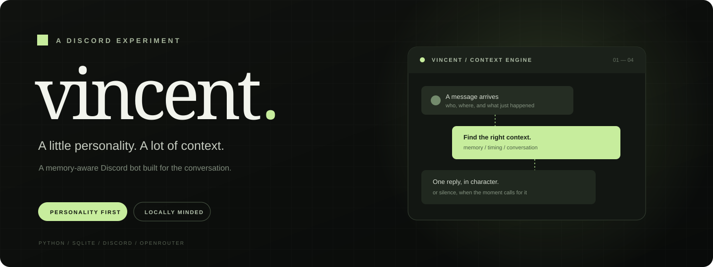
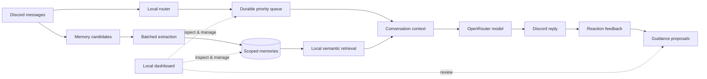

<p align="center">
  
</p>

<p align="center">
  <strong>A Discord regular with an actual sense of context.</strong><br>
  Personality-driven conversation, long-term memory, and a control room for the person behind the bot.
</p>

<p align="center">
  <a href="#what-makes-vincent-different">Features</a> ·
  <a href="#how-it-works">Architecture</a> ·
  <a href="#getting-started">Getting started</a> ·
  <a href="#commands">Commands</a> ·
  <a href="#project-status">Project status</a>
</p>

---

Vincent is a personal Discord bot built to feel like a participant in a busy group chat. He has a distinct voice, remembers things about the community, and tries to understand when a message is actually meant for him. Under the personality is a system designed around a practical constraint: a limited daily model-request budget.

> **A note on examples:** The bot's real server conversations, message exports, logs, personal memories and credentials are private and are not part of this repository. The evaluation cases included here are fictional.

## What makes Vincent different

**A personality that fits the moment.** Vincent can be sarcastic, impulsive and playful, but doesn't have to turn every message into a punchline. His response can be a roast, a simple reaction, a useful answer or silence, depending on the exchange.

**Memory with context.** User-scoped facts and relationship observations sit alongside global and server memories. A local multilingual embedding model finds relevant context from meaning as well as keywords. Memory extraction happens in batches; retrieval does not spend OpenRouter requests.

**Built for a busy channel.** Local routing detects direct mentions, replies and possible follow-ups. A durable queue manages concurrent conversations, with optional batching of compatible direct requests. Replies that need personal memory are handled separately.

**A feedback loop with oversight.** Members can rate responses with reactions. Ratings can inform proposed guidance, and the dashboard provides tools to inspect it. The core personality stays separate; automatic promotion is disabled by default.

**A small local control room.** The dashboard provides a view of activity, queue state, request usage, memories, profiles and guidance. It also provides controls for the bot and per-channel features.

## How it works



The router and semantic retrieval run locally. Only generation and batched background work use model requests. SQLite records queue state, request accounting, provenance and events; the embedding model and its cache run on the CPU. Relevant context is sent to the configured OpenRouter model when a reply is generated.

| Layer | Implementation |
| --- | --- |
| Discord and concurrency | Python, `discord.py`, `asyncio` |
| Model access | OpenRouter via `httpx`, with local request reservations and category limits |
| Long-term memory | SQLite, source-linked extraction and local multilingual ONNX embeddings |
| Control room | Local Python HTTP server and a lightweight HTML/CSS/JavaScript interface |
| Verification | `unittest`, synthetic fixtures, replay tools and GitHub Actions |

## Getting started

**Requirements:** Python 3.12, a Discord bot with Message Content intent enabled, access to the target channel, and an OpenRouter API key. The local embedding model uses CPU inference and downloads approximately 135 MB on first setup.

### 1. Install

```bash
python3 -m venv .venv
source .venv/bin/activate
python -m pip install -r requirements.txt
python -m vincent.semantic_memory
```

### 2. Configure

```bash
cp .env.example .env
```

Edit `.env` to set `DISCORD_TOKEN`, `OPENROUTER_API_KEY`, `OPENROUTER_MODEL`, `CHANNEL_IDS` and `VINCENT_OWNER_ID`. Use numeric Discord IDs; `CHANNEL_IDS` accepts a comma-separated list. Set the request ceilings and reset time to match your provider. Configure bot permissions to view the channel, read history, send messages and add reactions. Server Members intent is only required for optional welcomes.

The included personality and seeded identity are specific to Vincent's original community. To adapt the character for another server, review `vincent/prompts/core.txt`, `vincent/prompts/seed.txt`, and the seeded identity in `vincent/app.py`.

Run the offline configuration check:

```bash
python -m vincent.preflight
```

### 3. Run

```bash
python -m vincent.dashboard_server
```

Open **http://127.0.0.1:8765** and start the bot from the dashboard. Alternatively, start it directly with `python -m vincent.app`. Run only one bot instance per account. The dashboard can stop a bot it started; closing it also stops that managed process.

The dashboard binds to the local machine and is not intended for exposure to the public internet. If the embedding model is unavailable, the bot logs an error and falls back to keyword matching until the model is installed.

## Commands

| Command | What it does |
| --- | --- |
| `!vin help` | Show available commands |
| `!vin quota` | Show local request usage and the latest provider snapshot |
| `!vin memory list` | Send your stored memories to you by DM |
| `!vin memory add TEXT` | Save a fact about yourself |
| `!vin memory correct ID TEXT` / `delete ID` | Correct or remove a memory |
| `!vin memory forget` | Delete your profile memories |
| `!vin memory off` / `on` | Disable or enable collection and use |
| `!vin data forget` | Remove local user-linked data and disable collection |
| `!vin admin status` | View operational status, with server management permission |
| `!vin admin feature unsolicited on` | Enable optional participation in the current channel |

See [CHEATSHEET.md](CHEATSHEET.md) for the complete command list and local management tools.

## Privacy and data

Vincent stores conversation text, model request context, events and memories in a local SQLite database. Attachment metadata may be recorded, but media files are not downloaded. Conversation context is sent to the configured model provider for generation and extraction; provider retention and policies are separate from local controls.

Memory records are scoped, linked to source messages and can be corrected or deleted. Users can turn memory collection off or request deletion of local user-linked data. Deletion cannot retract Discord messages already sent, provider-side copies or separate backups. Treat the database, logs, exports and screenshots as sensitive.

The `.gitignore` excludes `.env` files, local data and the original server research. Review the actual files selected for commit before publishing; ignore rules do not remove files already tracked by Git.

## Tests & evaluation

```bash
python -m unittest discover -s tests -v
python -m evaluation.check_routing
```

Tests use synthetic conversations and mocked Discord/provider interactions, with local semantic-model tests when the model is available. The [evaluation harness](evaluation/README.md) includes fictional scenarios and optional archive replay tools. These are development checks, not a measured claim about real-world humor quality or retrieval accuracy.

## Project status

Vincent has been used in a real server and remains an evolving personal project. Memory extraction, semantic matching, social timing and provider behavior are imperfect; request limits and queue expiry can delay or drop work. Offline messages are not automatically backfilled. See [project status](docs/PROGRESS.md) and [deployment notes](docs/DEPLOYMENT.md) for limitations and operational checks.

```text
vincent/          Discord adapter, context, memory, queue, dashboard and migrations
vincent/prompts/  Core voice and seed guidance
vincent/dashboard/  Local control-room frontend
tests/            Unit and integration tests
evaluation/       Synthetic scenarios and offline evaluation tools
docs/             Architecture, status and deployment notes
```
